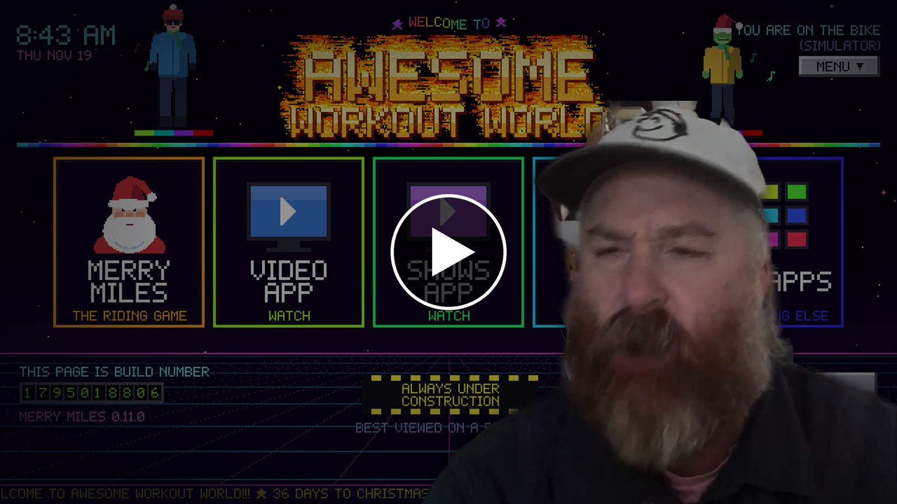

# Awesome Workout World + Merry Miles

A home screen and a Christmas walking and riding game for a family's Peloton Bike and Tread. Not made by, approved by, or
known to Peloton.

[](https://its837.github.io/awesome-workout-world/#trailer "Play trailer")

> **Point your Claude here, plug shit in, and go nuts. Good luck. It might break!**
>
> This is made to be set up *with an AI*. Read
> [FOR_STUPID_PEOPLE_USING_AI_TO_DO_THINGS_THEY_SHOULDNT.md](FOR_STUPID_PEOPLE_USING_AI_TO_DO_THINGS_THEY_SHOULDNT.md)
> first (short), then give your Claude the
> [Family Meeting](docs/FAMILY_MEETING.md): it interviews you about your people, your pets,
> the relatives who are not here any more, what you eat and your weird stupid stuff, and
> writes it all into the game. Or go rogue: the [Rogue Meeting](docs/ROGUE_MEETING.md), where you
> say your family's dreams out loud and your AI builds them into the game. Then
> [docs/INSTALL.md](docs/INSTALL.md) puts it on a Peloton.
> Everything stays on your computer and your Peloton unless you choose the
> [advanced set-up](docs/ADVANCED_SETUP.md) (more than one Peloton, or friends). At the end of
> the season there is a prompt for a [Wrapped video](docs/WRAPPED.md).

**Start here**

- **Make it your family's:** have a [Family Meeting](docs/FAMILY_MEETING.md) (an AI asks, you
  answer) or go rogue with the [Rogue Meeting](docs/ROGUE_MEETING.md) (you dream, an AI builds); [docs/YOUR_FAMILY.md](docs/YOUR_FAMILY.md) is what it writes, if you would rather do
  it by hand. The repository holds one made-up person (Nerd) and some outlines where your
  family goes; yours go in a `family/` folder that never leaves your computer.
- **Put it on a Peloton:** [docs/INSTALL.md](docs/INSTALL.md). Two ways: *side by side*
  (one more app; Peloton untouched) or *full takeover* (the tablet starts up into it).
- **What has been tried on which machine:** [docs/BIKE_AND_TREADMILL.md](docs/BIKE_AND_TREADMILL.md).
- **The website:** [its837.github.io/awesome-workout-world](https://its837.github.io/awesome-workout-world/) (the trailer, the advent calendar, and the game to try). The files are in `site/`; look at it yourself with `node tools/site.mjs`.

- **Awesome Workout World** is the tablet's home page. It is not about riding: it is the
  front door to everything on the device. The apps (the riding game and ALL APPS for
  everything else, Peloton's own home included; and, if you ask for them in the family
  meeting, YouTube, Netflix, Hulu and a music app, which you add yourself), the build number that
  is running, and the device's own settings. It is dressed as a home page from the early web that wishes it was the
  1980s: a flaming title, rainbow rules, a hit counter, a marquee, the family's dogs
  dancing, and a rainbow explosion wherever you touch.
- **Merry Miles** is the riding game: a pixel-art winter world that moves when you do,
  family profiles in Santa hats, a mile a day to get home for Christmas, and an advent
  calendar that hands out the good stuff one door at a time.

## What's next, in order

1. **Try it on the real tablets.** Plug each one in, run the read-only check, take the
   baseline snapshot, install, and run `tools/android.sh speedtest`. Then the sensor
   readers can be written for the machines we actually have. Also install the Netflix,
   Hulu and Spotify apps and find out which of them play, and how YouTube is best
   reached (see "Watching YouTube, Netflix, Hulu and Spotify"). See "Getting it onto the
   real Peloton" below.
2. **Take the family out of the code, so the project can go on a public Git repository.**
   Today the family is part of the game's files: `web/profiles.js` holds the names, looks,
   heights and which dog runs with whom, and `web/photos/` is where the photos will go.
   Names also
   appear as examples in this README, `EASTER_EGGS.md`, `tools/android.sh`, the research
   report and comments in four source files. The plan: the public game ships with a
   stand-in family; the real one is a single private file (names, looks, photos) that the
   tablets fetch from the online home in step 3 and keep a copy of, so a ride still works
   without Wi-Fi. Per-tablet reports (`docs/tablets/`) and save-data backups (`backups/`)
   stay out of the repository too.
3. **The online home. This is the goal.** One small private service that holds three
   things: the family file from step 2, the shared ride log (so your progress, tent and
   advent door follow you whether you biked or skinned), and the game's files for
   over-the-air updates. Until it exists each machine keeps its own trail and "Check for
   updates" has nowhere to look. It needs an account that the owner creates, a family key so
   strangers cannot write to it, and signed updates so only we can publish.

Steps 2 and 3 go together: the private family file needs somewhere private to live.

Also wanted, not started:

- **A blizzard.** A snowstorm that rolls in during a ride now and then: heavy snow, wind,
  the mist closing right in, then clearing.
- **Video over the game (picture in picture).** Researched, deliberately not built yet:
  see `research_notes/Picture in picture options.md`.

## What is in the game

- **On the bike → Moonlight Singletrack.** A fat bike on a groomed trail at night. Your legs on
  screen turn at your real cadence; turning the resistance knob tilts the trail.
- **On the treadmill → Dawn Patrol.** Skinning up a mountain with a pack and poles. The incline
  you set is the slope you see. The ride is decided by the machine you are standing on.
- **Night, then sunrise.** Every ride is at night; once the SUNRISE door is open, the sun
  comes up as you finish your mile.
- **The family trail.** Everyone is trying to get home to the family homestead for Christmas.
  The trail opens on Thanksgiving Day and has one mile for each day up to and including
  Christmas Day (thirty this year), so a mile a day gets you home. A mile is a mile:
  one walked or one ridden moves your tent a mile, so riders get along faster than walkers.
  When you stop, that is where you camp, and your next outing starts from there on
  whichever machine you use. Ride past someone's tent and you see it by the trail. The
  **map** shows everybody, the family's miles added together, and the places along the way.
- **Places.** There are fourteen places to every trail mile, cycling through nine landscapes
  (so a place lasts about a minute and a half at walking pace). They are fixed spots on
  the trail: mile 3.2 is the same place on the bike and on the treadmill.
- **The trail panel.** A tab on the right edge of a ride opens a live straight-line map of
  what is coming, like a sat-nav: the next places, mile marks, other people's tents, the
  next reward. CLOSER and WIDER zoom it from the next fifth of a mile to the whole trail.
- **The day's goal is one mile.** On the treadmill or on the bike, less
  whatever you have already done today. Reach it and the game says so; keep going as long
  as you like. There are no minute goals to choose any more.
- **The advent calendar.** One door for every day, Thanksgiving to Christmas. A door whose
  day has not come, or that you have not earned, wears a padlock. **Every minute you ride or
  walk unlocks the next door**, one door a minute, so three missed days take three minutes.
  **An unlocked door does not open itself: you tap it.** On a ride it comes and hovers on
  your right, rattling, until you do; then it opens there, in a card beside you that never
  covers the rider. One door at a time, in order. Leave it and it is still waiting on your
  own calendar afterwards, where a tap opens it too. Under every door on your calendar is
  what it takes (WALK 1 MIN, TOMORROW) or what was in it.
- **Three piles of things, kept apart.** They are all listed in one catalog,
  [web/src/gifts.js](web/src/gifts.js), which also says how to add one.
  *Advent things* are the cool stuff: the trail buddies (the Thanksgiving turkey, cardinal,
  fox, penguin, owl, kangaroo), the family's dogs, the feasts (hot bowl of
  worm soup, dynamite, fancy avo toast, penguin milk), the people who arrive
  part-way through, and the surprises (reindeer, Rudolph, Santa's sleigh, the northern
  lights, the yeti, the igloo, snow flurries, disco snow, drop bears, sunrise, the dogs'
  poop breaks, a sled with a Christmas tree on it that you tow behind you, a cake on
  December 24, and a relative of your choice who flies in as a friendly spirit, says
  hello, flies beside you for a while and flies off).
  There are two **tools** ([web/src/tools.js](web/src/tools.js)), on a strip of their own above YOUR ITEMS: pick one up,
  then tap the trail. The **long smelly finger** (November 27) pushes snowmen over; the **laser gun** (November 29) melts
  snowmen and shoots reindeer, who end up on their backs with blood on the snow. Two more turn up beside you to cheer you on, one at a time
  ([web/src/visitor.js](web/src/visitor.js)): **Sexy Santa** (December 23, late on purpose), the chubby belly dancer in a
  bikini, and **Edward** (December 14), a pale, sparkling, shirtless brooder with a wolf's paws, ears and
  tail (our own send-up of the type: he copies nobody's character and quotes nobody). You catch them up on the trail,
  where they are going backwards so they can face you; tap one and it does its party piece. Songs are not advent
  things: every song is in the songbook from the start.
  **Penguin milk** shares the penguin's door (December 8): when the door opens the penguin fills a glass
  ([web/src/milk.js](web/src/milk.js)), you drink it, and from then on it is in your items.
  **When a door opens there is a show** ([web/src/door.js](web/src/door.js)): a knock, the
  door swings back, the thing pops out with confetti and says something. Tap any door you
  have opened, on your own calendar or the family's, to watch it again in the panel on the
  right. On Thanksgiving everything says
  HAPPY THANKSGIVING and GOBBLE GOBBLE.
  **Whatever is behind a door is not in your game at all until you open that door**; from
  then on it is yours on every ride. A door can hold more than one thing, so there is
  always room for another. Take something off the calendar and it is simply always there.
  *Earned things* are not behind a door. Sprinkle Power Poop is the first: do your mile
  three days in a row and every poop break sparkles and pays out, for as long as the
  streak lasts.
  *Rewards* are the extras picked from a card every mile: cookies and sparkle. They last
  for the ride you pick them on. Prime rib and the flat white used to be behind doors; they are
  ordinary treats on those cards now, because Sexy Santa and Edward have their doors.
- **Your items.** The food from the calendar (worm soup, dynamite, avo toast, penguin milk,
  the birthday cake) is a strip of pictures on the left edge of a ride. Tap
  one to eat it: full spirit and points. Two minutes of riding later it is ready again.
  The arrow beside the strip pops it straight out sideways into names and timers. Both
  side tabs (this one, and the trail panel's on the right) stay at the same height
  whether their panel is in or out.
- **Not everybody at once.** Everything you have opened is yours, but only a couple of
  buddies and one dog are about at a time. They come and go every half minute or so, and
  sometimes nobody is about. Every several minutes THE WHOLE GANG turns up together for
  half a minute. (`_direct` and `gather` in [web/src/ride.js](web/src/ride.js).)
- **The outhouse.** Every few minutes there is one beside the trail. Tap it: 75 points, a
  top-up of spirit, and its little moon lights up because somebody is in there.
- **Everybody has** the North Pole in the village and fireworks when their mile is done;
  neither is behind a door any more.
- **Not everybody is here from the start.** Somebody with `arrives: '12-09'` in the family file is
  behind that day's door: they join the welcome screen when somebody opens it (the next day
  at the latest) and their mile a day counts from the day after. A dog can arrive late too.
- **The dogs are family, but nobody rides as a dog.** A dog joins once the people named in its `unlockedBy`
  have each opened its door. Then it runs back and forth along the welcome line-up (tap it
  for its numbers), comes and goes on everybody's rides, and whatever it runs beside you is
  its own distance too: each dog has its own miles on the map and its own count of poop
  breaks. A dog with `poop: 3` stops about three times as often as the others.
- **The welcome screen.** Opening Merry Miles shows the start of the journey: the name of
  the challenge, how far the family has come together, the whole trail on one line with
  everybody's flag on it, and WHO ARE YOU? over everybody who is here, standing in the
  snow at their real heights with their miles under them.
- **Your own advent calendar.** Tap yourself and the whole screen becomes your calendar,
  with nothing else on it: every door (the ones you have opened show what was inside),
  today's door waiting, today's goal, a list of everything you have got, a link to the
  family's calendar, and LET'S GO.
- **The dogs on a ride.** They
  turn up on everybody's rides the way they do on a walk: out of the trees, alongside for a
  while, gone again, sometimes one, sometimes both. About once a mile one of them stops for
  a poop and catches up afterwards (once the POOP BREAKS door is open). They only come
  along once you have opened their doors. One switch in the game's Settings turns them off.
- **Mile rewards you pick by touch.** Every mile on the bike (every quarter mile on the tread)
  three big cards appear: cookies, or some sparkle. Untouched, it picks itself.
  A cookie gets eaten in three bites before it fills your spirit.
- **Music you can steer.** Bottom left of a ride: pause, skip, and (tap the song name) the
  songbook. Eleven traditional carols on shuffling instruments, plus seven tunes written
  for the game, each in a borrowed style with its own melody: *Neon Snowfall* (1980s
  synth-pop), *Sleigh Bell Shuffle* (big bouncy 1960s-style pop), *Rooftop Boogie*
  (1950s rock and roll), and two in a 1960s brass-band pop style with two trumpets in
  thirds, which take the names of your first two dogs (*Waffle's Cha-Cha* and *The Biscuit Two-Step* in the starter family). None of them copies an existing
  song. Every song is in the songbook from the start.
- **Nothing happens on a loop.** The buddies choose what to do next at random (beside you,
  on ahead, dropping back, swapping sides, off into the trees), and the surprises that come
  and go (the relative who flies in, Sexy Santa, Edward, drop bears, disco snow, flurries) turn up at random, minutes apart.
- **Numbers you can shrink.** The little arrow beside the stat tiles turns them into one thin
  strip. The MILES tile still flips to cookies burned when tapped; the other flips are gone.
- **Nine landscapes** and hidden extras ([EASTER_EGGS.md](EASTER_EGGS.md), spoilers).

Names are constants in [web/src/config.js](web/src/config.js).

## Putting it in any situation you want to see

**The DEV buttons are only for the family's Dev** (`tester: true` in
[web/profiles.js](web/profiles.js); `nerd` in the starter family). Whenever no real machine is attached (in a
browser or the emulator), or with Settings → DEV CONTROLS on, the tester gets a gold
**DEV** button on their own advent calendar (it opens the Workshop, called DEV CONTROLS
below) and a gold **DEV** button top-right on their own rides. Nobody else sees either.

- **Try any advent thing, whatever the calendar says:** in a ride, DEV → **THINGS**. Every
  thing in the catalog is a button: tap one and it happens now (the relative drops by, a dog
  runs in, a dog poops, a drop bear lands, the turkey gobbles...). DOOR ◀ / DOOR ▶ play the
  door-opening show for each door in turn. Nothing done there is saved. On the tester's
  calendar, tapping any door twice plays its show too, shut or not.

- **Change machine:** in a ride, tap DEV and then BIKE or TREADMILL at the top of the
  drawer. The same ride restarts on the other machine, same person, same place.
  Outside a ride: DEV CONTROLS → BIKE / TREADMILL.
- **Change where you are:** in a ride, DEV → ZONE ◀ / ZONE ▶. Or DEV CONTROLS → tap any
  landscape under "Start a dev ride", after choosing who rides and whether to begin at the
  start, halfway or near the end.
- **Change when it is:** DEV CONTROLS → DAY ◀ / DAY ▶ / WEEK ▶ (for the advent calendar),
  or in a ride DEV → +1 MIN (a minute unlocks the next door) and +1 MILE (for the goal
  and the sunrise). DEV CONTROLS → ADVENT DOORS switches between "as the calendar says"
  and "all open for everybody".
- **Make things happen:** in a ride, DEV → REWARD, +1 MILE, SPIRIT, LIGHTS, GOAL (jump to
  just short of today's mile), COOKIE, and FASTER / SLOWER / HARDER / EASIER / STOP to drive
  the pretend machine. (+1 MILE gives one treat card, not one for every reward point it
  jumped over.)
- **Change how it looks:** in a ride, DEV → **LOOK**. Pick AUTO / FULL / MEDIUM / LIGHT, or
  turn the dials one at a time: TREES (100 / 70 / 45 / 25%), FOG (clear / misty / thick),
  SNOW, GLOW. SKY pins the time of day (night, dawn, sun-up, day). The lines underneath
  show frames per second, how many milliseconds of each frame are our own work, and how
  many things are being drawn. What you choose is saved, same as Settings → PICTURE DETAIL.
- **See how a slower tablet would cope:** DEV → LOOK → SLOW makes every frame cost 4 or
  6 times as much. SPEED DEV (there, and on the DEV CONTROLS screen) runs the busiest
  scene at each detail level and shows the numbers.
- **Give the map some tents:** DEV CONTROLS → FILL WITH PRETEND RIDES.

From the Mac, one line puts the emulator straight into a situation:

```bash
tools/android.sh scene machine=tread rider=alex zone=snow-ghost-ridge at=0.95
```

```bash
tools/android.sh scene machine=bike rider=riley reward=1
```

```bash
tools/android.sh scene demo=1 day=+20 screen=map
```

```bash
tools/android.sh scene rider=nerd buddies=owl time=night detail=light
```

```bash
tools/android.sh speedtest
```

```bash
tools/android.sh scenes
```

`speedtest` prints frames per second at each detail level for whatever is plugged in (the
emulator now, a real tablet later). `scenes` lists every value you can use. The same words work in a browser address:
`http://localhost:5173/?machine=tread&rider=alex&at=0.95`.

The map is reachable from the Merry Miles front page, the pause menu during a ride, and
the end-of-ride card. The test controls are reached from the tester's own calendar and rides, never from Awesome Workout World.

## How much it draws, and whether the tablet will keep up

**Settings → PICTURE DETAIL** has four choices. The far mountains, hills and horizon
treeline are in all of them: they are baked pictures and cost almost nothing.

| Choice | What you see |
| --- | --- |
| FULL | Every tree, visible 200 m up the trail, a halo on every fairy light in range. The thick-forest look. |
| MEDIUM | 70% of the trees, mist that closes in at about 115 m, halos only on trees near you. |
| LIGHT | 45% of the trees, thick mist at about 75 m, fewer snowflakes, no halos. An open trail under a big sky. |
| AUTO (the default) | MEDIUM. If the tablet cannot hold 60 frames a second it drops to LIGHT, and if LIGHT cannot either, to LIGHT at a steady 30 (which looks smoother than a frame rate that wobbles). It climbs back only after three comfortable minutes, and never to FULL. |

Measured on this Mac's emulator (Android 11, the same generation of built-in browser as the
tablets) in the busiest scene we have: thickest forest, every tree lit, all four buddies, a
dog, fairy lights on the rider.

| | Frames per second | Our work per frame | Processor 4.4× slower | Processor 5.5× slower |
| --- | --- | --- | --- | --- |
| FULL | 58 | 5.0 ms | 44 frames per second | 33 |
| MEDIUM | 60 | 3.3 ms | 59 | 60 |
| LIGHT | 60 | 2.6 ms | 60 | 59 |

5.5× is roughly the gap between this Mac and the older Bike's processor on published
benchmarks, and 4.4× the gap to the Bike+ and Tread. Those two columns are the same test
with our own work made to take that many times longer (`tools/android.sh speedtest
slow=5.5`). They know nothing about the tablet's graphics chip, which nobody has measured
for this kind of drawing. So: MEDIUM should hold on both, FULL will not on either, and
the real answer is one command with the tablet on the cable (`tools/android.sh
speedtest`), or the SPEED TEST button on the tablet itself. Its result also tells AUTO
where to start.

**The emulator crawls when its window is hidden.** macOS throttles it to a few percent of
its speed whenever its window is covered by other windows or minimised (the app then
takes 15 seconds to start and runs at a frame or two a second). Keep it in view while you
judge speed. `tools/android.sh emulator headless` runs it with no window, which macOS
leaves alone; that is what the numbers above used.

**When is it night?** Every ride, on both machines, happens at night. The sky only starts
to pale over the last 15% of the way to your goal, the sun comes up as you reach it, and
it stays a low golden sunrise for as long as you keep going. A free ride (today's mile
already done) treats one trail mile as its goal. Until the SUNRISE door is open, and with
game Settings → THE SKY → ALWAYS NIGHT, the sun never comes up.

## Run it on the Mac (browser)

```bash
node tools/serve.mjs
```

Then open http://localhost:5173. Arrow keys drive the pretend machine (up/down = cadence or
speed, left/right = resistance or incline), `A` toggles auto, `P` pauses, `1` `2` `3` pick a
reward. Everything else is in the Workshop. `?machine=tread` in the address starts as a
treadmill, `?screen=people` skips the home screen. Add `&preview=1` to any address to see
it with a pretend family history on day ten of the season, without saving anything.

There is nothing to install and no build step for the game: it is plain JavaScript with zero
dependencies. That is deliberate — this folder lives in Google Drive, where a `node_modules`
folder would sync thousands of files.

## Run it as the tablet app (emulator)

The Android tools are installed on this Mac (JDK 17 via Homebrew, Android SDK in
`~/Library/Android/sdk`). One script does everything:

```bash
tools/android.sh emulator
```

```bash
tools/android.sh build
```

```bash
tools/android.sh install
```

```bash
tools/android.sh run bike
```

`emulator` starts a 1920×1080 Android 11 tablet shaped like the Peloton screen. Plain `run`
launches the app with its on-screen simulator and the Workshop (this is the one for looking
around). `run bike` or `run tread` instead feeds it made-up sensor readings through the same
path the real ones will use, which is for testing the plumbing. Build output goes to
`~/Library/Caches/MerryMiles`, not into Google Drive.

## Updating the game on the tablet without a cable

The tablet app has two layers. The **shell** (the Android app itself) only changes with a
USB install. The **game** (everything in `web/`: home screen, rides, map, songs) can be
replaced over Wi-Fi:

```bash
tools/android.sh publish
```

That stamps `web/` with a new build number (the one Awesome Workout World shows in its hit counter). On
the tablet: Awesome Workout World → DEVICE SETTINGS → **Check for updates**
→ **Restart to update**. The tablet downloads only the files that changed, checks every one
against its fingerprint, and switches over. If a new version fails to start, the tablet
drops it after 30 seconds and goes back to the one before, and will not take that build again.

Right now the update address is this Mac's dev server (the emulator is pointed at it
automatically). For the real tablets we still need to choose where updates live; see
[docs/ARCHITECTURE.md](docs/ARCHITECTURE.md).

## Going back, and keeping the save data safe

Nothing we do to a tablet should be a one-way door. The full list of ways back, from one
tap to a factory reset, is in [docs/REWIND.md](docs/REWIND.md). The short version:

- The **PELOTON** tile on the home screen opens Peloton's own screens at any time.
- **Awesome Workout World → DEVICE SETTINGS → Home button** hands the Home button back; **WAYS BACK** opens a rescue screen
  that works even if the game does not. If Awesome Workout World fails to start three times running it
  hands the Home button back by itself.
- `tools/tablet-snapshot.sh` records a tablet's state before we change anything, and
  `tools/tablet-restore.sh --apply` puts it back and removes our app.
- `tools/tablet-backup.sh` copies the family's rides to `backups/` on this Mac, and
  `tools/tablet-backup.sh restore <file>` puts them back, on the same tablet or a new one.
- On a treadmill, Awesome Workout World will not take the Home button and our tools switch nothing off.

## Make it yours

- **Family:** your own live in `family/` (see [docs/YOUR_FAMILY.md](docs/YOUR_FAMILY.md); the
  [Family Meeting](docs/FAMILY_MEETING.md) writes them for you). The starter in
  [web/profiles.js](web/profiles.js) is one made-up person, Nerd. Names, heights, jacket colours,
  and how each person is drawn (skin, hair colour and style, beard, glasses, hat, or dog /
  frog). The easy way to change it is the Family Meeting.
- **The challenge's name, the places, what is behind each door:** [web/tweaks.js](web/tweaks.js), written by hand or by your AI. Empty it and the game goes back to its built-in names.
- **Photos:** drop a face-centred picture into `web/photos/` and put its file name in that
  person's `photo:` field. It is pixelated automatically and gets a Santa hat.
- **Songs:** [web/src/carols.js](web/src/carols.js) is a plain-text songbook (notes and chords).
  The carols are traditional and public domain; the tunes marked `original` were written
  for the game in a borrowed style, with melodies of their own. Nothing to license.
- **Advent things and their door order:** [web/src/gifts.js](web/src/gifts.js). **Rewards:**
  [web/src/rewards.js](web/src/rewards.js). **Landscapes:** the `ZONES` list at the
  top of [web/src/world.js](web/src/world.js). **Silly stats:** the `TILES` list at the top of
  [web/src/ride.js](web/src/ride.js).

## How it is put together

| Part | Where | What it does |
| --- | --- | --- |
| Game | [web/](web/) | Everything you see and hear. Runs in any modern browser. |
| Trail renderer | [web/src/world.js](web/src/world.js) | Endless trail, zones, scenery, pickups. |
| Pixel art | [web/src/sprites.js](web/src/sprites.js) | Every sprite is drawn by code, no image files. |
| Sky | [web/src/sky.js](web/src/sky.js), [web/src/env.js](web/src/env.js) | Moon, aurora, mountains, time of day. |
| Rider | [web/src/rider.js](web/src/rider.js), [web/src/dogs.js](web/src/dogs.js) | The biker / skier / dog seen from behind, their buddies and sparkle. |
| People | [web/src/figure.js](web/src/figure.js), [web/src/portraits.js](web/src/portraits.js) | Everybody from the front and the side, at their real height, and the round faces. One "look" drives all of them. |
| Season | [web/src/camp.js](web/src/camp.js), [web/src/session.js](web/src/session.js), [web/src/gifts.js](web/src/gifts.js) | The ride log, tent positions, the advent doors, what is behind them, and who is here yet. |
| Awesome Workout World | launcher, device, retro (in `web/src/`) | The tablet's home page, the device settings, and the retro effects. |
| Game screens | home, mapscreen, advent, settings, workshop (in `web/src/`) | Who are you / your calendar, map, family calendar, game settings, test tools. |
| Machine | [web/src/machine.js](web/src/machine.js) | One interface for "the bike or tread": real sensors or the simulator. |
| Tablet shell | [android/](android/) | A thin Android app: shows the game full-screen, feeds it sensor data, opens things to watch. |

The picture is drawn at 640×360 and scaled up exactly 3× on the tablets' 1920×1080 screens,
which is where the chunky-but-clean pixel look comes from.

## Getting it onto the real Peloton

**The step-by-step for the first evening, and which machine to start with, is in
[docs/FIRST_TEST.md](docs/FIRST_TEST.md); the real, current steps are in [docs/INSTALL.md](docs/INSTALL.md).** (On 17 November 2026 the treadmill ran it for real; the bike has not been connected yet: see [docs/BIKE_AND_TREADMILL.md](docs/BIKE_AND_TREADMILL.md).) The research behind this plan is in
[reports/Peloton tablet modding methods.md](reports/Peloton%20tablet%20modding%20methods.md), and
the design decisions are in [docs/ARCHITECTURE.md](docs/ARCHITECTURE.md). Every step is
unverified on our own machines until we try it.

1. **Keep the tablets off Wi-Fi updates.** A Peloton system update can remove sideloaded apps
   and switch developer mode back off.
2. **Turn on USB debugging** on a tablet (Settings → About tablet → tap *Build number* 7
   times → Developer options) and connect it with a cable that carries data: micro-USB on
   the back of the original Bike's screen, USB-C on Bike+ and Tread.
3. **Read the tablet, change nothing:**

   ```bash
   tools/tablet-check.sh
   ```

   This reports the model, build, which Peloton it is, and what that build is known for.
4. **Try installing** (`tools/android.sh install`). This is the step most likely to fail:
   some tablets without a membership refuse all installs. Better to find out with ours
   before anything else.
5. **Run it with the simulator**, loading the game from the Mac over Wi-Fi.
6. **Write and test the real sensor reader** for that exact machine.
7. **Make Awesome Workout World the home screen** from its DEVICE SETTINGS.

### Rules we keep

- **The treadmill is listen-only.** Its sensor service will also move the belt if asked.
  Our reader sends only "start listening" and "stop listening". The hand controls, the stop
  button and the safety key keep working exactly as they do today.
- **Never switch off `com.onepeloton.affernetservice`.** It is the sensor and belt controller.
- **Uninstall nothing.** Other owners remove or disable Peloton packages; we install, set
  the home screen, and only switch something off if we hit the specific problem it fixes.
- A factory reset is the way back to stock.

### Watching YouTube, Netflix, Hulu and Spotify

The home-screen tiles open the service's own Android app if it is installed on the tablet,
and otherwise its website in a built-in full-screen viewer (sign-ins are remembered).

**The emulator is a poor guide here.** It has none of these apps, so every tile falls back
to the website, shown in a 2020-era browser engine with no video copy-protection. What
that looks like (checked 14 November 2026): YouTube opens its mobile site signed out, and
Google does not allow signing in from inside another app's viewer; Netflix says "Update
required"; Spotify says "Unsupported browser". None of that says anything about the tablets.

On the tablets the tiles should open the real apps, once those are installed. Until then
the Netflix, Hulu and Spotify tiles say the app is not on this tablet yet (their websites
refuse a viewer like ours), and the YouTube tile opens YouTube's website in our viewer.
From other owners' reports, checked against our two models in
[docs/tablets/WHAT_WORKS.md](docs/tablets/WHAT_WORKS.md): Netflix works as an ordinary app,
Spotify has one thin report, Hulu installs but nobody has confirmed playback, and the
official YouTube app needs Google services the tablets do not have. Nobody has reported
YouTube's website in a viewer like ours on a Peloton: the reported routes are a small
embedded player (with a fix so the bike is sent a video format its chip plays smoothly) or a
full browser app. One known snag: since late 2025 Peloton's software closes
Netflix on tablets without a membership, and the reported fix is switching off a Peloton
component, which we have said we will not do on the treadmill. Unknown until we try:
picture quality, since nobody has reported what copy-protection level these tablets get.

**Next step:** watching *while* riding, with ride stats alongside the show.

## Ideas parked for later

- Santa-selfie: take the profile photo with the tablet camera.
- Controllers (or tapping the screen sides) to steer between lanes and grab bonus items.
- "Catch Rudolph" sprint challenges; a snowboard descent as the cool-down after Dawn Patrol.
- A floating Home button over other apps, if the tablet's own Home control is awkward.
- A proper recorded Santa voice.
- Other seasons: the world is data-driven enough to re-skin.

## Testing tips (for whoever works on this next)

`window.merry` is the running app. `merry.skip(30)` fast-forwards 30 seconds and
`merry.tap(x, y)` taps a point in the 640-wide picture. The Workshop does the rest.

## Licence

[MIT](LICENSE): fork it, change it, ship it, do whatever you like with it. There is no warranty, and it controls nothing
on a treadmill belt, but it might still break. The exceptions (the video of the author in `site/media/`, and trademarks) are in [NOTICE.md](NOTICE.md).
